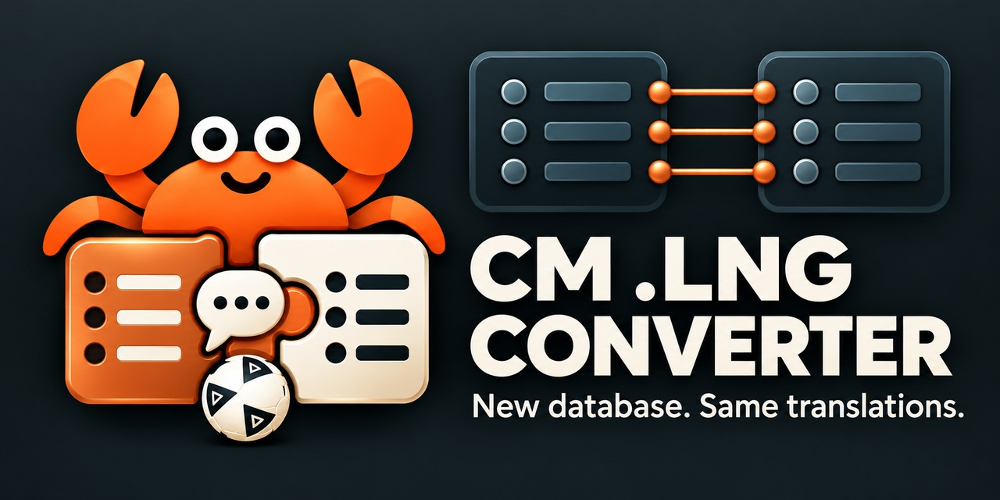

# Conversor de .lng do CM 01/02

*[English version](README.md) · [Türkçe](README.tr.md)*

Leva um arquivo de nomes traduzidos (`Data\<idioma>.lng`) do **Championship Manager 01/02 (3.9.68)** de um banco de dados para outro: a tradução feita para o banco de 2001 (ou para qualquer atualização) passa a servir num banco mais novo.

## O problema

O jogo lê os nomes traduzidos de clubes, nações, cidades, estádios e competições do `fra.lng`, `por.lng`, `ger.lng`... Os registros desses arquivos **não têm id**: o registro *i* vale para a entidade *i* do banco. Na carga, o jogo compara as quantidades do cabeçalho do arquivo com as do banco. Se uma não bate, ele mostra **"v3.9.68 Database..cpp 7784"** e não lê nenhum nome: tudo fica em inglês. Por isso um `.lng` feito para um banco não serve em outro.

O jogo também lê o **`eng.lng`**, com qualquer idioma escolhido, e faz a mesma conferência nele (aí o erro é **"Database..cpp 19953"**). Por isso o `eng.lng` tem de ser convertido junto com o arquivo do idioma.

## O que a ferramenta faz

Ela casa cada entidade do banco novo com a do banco velho pelo **nome em inglês**, usando a nação, a cidade ou o nome curto do clube para separar os homônimos. Depois copia a tradução de tudo o que existe nos dois e deixa em inglês só o que é novo ou foi renomeado: para um registro vazio, o jogo mantém o nome do banco. Como as traduções são casadas pelo nome, nada é copiado pela posição. Se uma posição foi reaproveitada para outra entidade (uma nação ou um prêmio trocado por outro), a tradução antiga não vai junto.

Ela grava um relatório com as quantidades traduzidas e as que ficaram em inglês em cada tabela, e as listas para o tradutor: o que foi renomeado e as traduções perdidas, com a tradução antiga ao lado.

Exemplo: o `fra.lng` original de 2001, levado ao banco da CLZ 25-26, ficou com 6/6 continentes, 209/231 nações, 269 clubes, 134 cidades e 229 prêmios traduzidos. O jogo abriu sem erro e com os nomes traduzidos.

## Download

Baixe o **`lng_converter.exe`** na página de [Releases](../../releases). É um arquivo só, com o Python embutido: não precisa instalar mais nada.

## Uso

1. Abra o `lng_converter.exe`.
2. Preencha os quatro campos:
   - **Translated .lng file:** o arquivo a converter (ex. `fra.lng`). A pasta dele entra no campo seguinte.
   - **Data folder of the database it was made for:** a pasta `Data` do banco para o qual esse arquivo foi feito. O `eng.lng` também sai daqui.
   - **Data folder of the new database:** a pasta `Data` do banco que você quer usar.
   - **Output folder:** onde gravar. Pode ser a própria pasta `Data` do jogo novo: o arquivo que já estava lá fica guardado como `.bak`.
3. Deixe marcado **"Also convert eng.lng"**.
4. Clique em **Convert**. O relatório aparece na janela e fica salvo como `lng_converter_report.txt` na pasta de saída. A primeira linha de cada arquivo diz se o jogo vai aceitá-lo.

Guarde uma cópia da pasta do jogo antes de trocar os arquivos.

### Linha de comando

Com o Python 3 instalado, as mesmas ferramentas rodam sem a janela:

```
python lng_converter.py <entrada.lng> <Data velha> <Data nova> <saída.lng> [--completar] [-v]
python lng_confere.py <arquivo.lng> <Data>
```

- O `--completar` é para o `eng.lng`: a entidade sem par recebe o texto em inglês do próprio banco novo em vez do registro vazio, porque ao ler o `eng.lng` o jogo não cai no nome do banco.
- O `lng_confere.py` diz, sem abrir o jogo, se ele vai aceitar um `.lng` com um banco.

## Arquivos

| Arquivo | O que é |
|---|---|
| `lng_converter_gui.py` | a janela (a fonte do `lng_converter.exe`) |
| `lng_converter.py` | a conversão |
| `lng_confere.py` | a conferência que o jogo faz ao carregar um `.lng` |
| `build.bat` | gera o `lng_converter.exe` pelo PyInstaller |
| [`docs/LNG_FORMAT.md`](docs/LNG_FORMAT.md) | o formato do `.lng`, com os endereços do jogo |

Para compilar: `pip install pyinstaller` e depois `build.bat`. O exe sai em `dist\`.

Nenhum arquivo do jogo está neste repositório: a ferramenta lê os `.dat` e os `.lng` da pasta do seu próprio jogo.

## Licença

[MIT](LICENSE): uso, alteração e compartilhamento livres, inclusive em outros projetos, desde que o aviso de direitos autorais seja mantido (o crédito ao autor). O jogo em si não está incluído: pertence aos seus donos.

## Sobre

Parte do projeto **CM 01/02 em Rust**, que faz a engenharia reversa da 3.9.68 e a reescreve rotina por rotina. A análise do código do jogo foi feita com a ajuda de inteligência artificial. Obrigado à comunidade do champman0102 e a todos que mantêm o 01/02 vivo.

Dúvidas: abra uma issue ou mande mensagem para **lucastmpacheco** no [fórum champman0102](https://champman0102.net).
