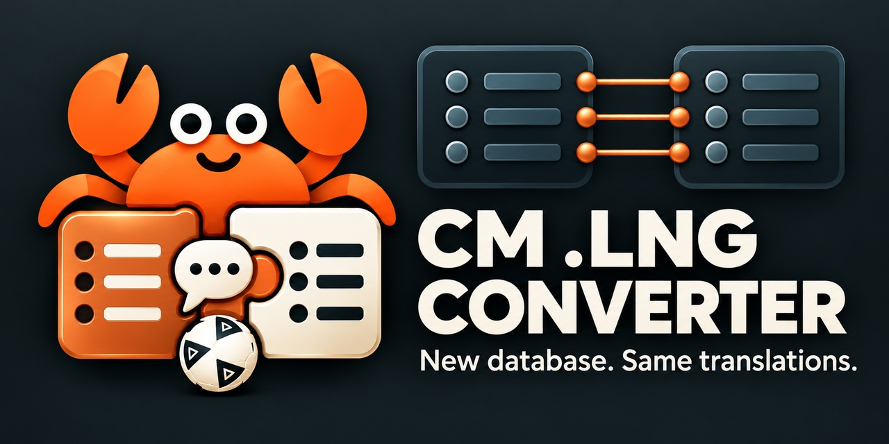

# CM 01/02 .lng dönüştürücü

*[English version](README.md) · [Versão em português](README.pt.md)*

**Championship Manager 01/02 (3.9.68)** için çevrilmiş isim dosyasını (`Data\<dil>.lng`) bir veritabanından diğerine taşır: 2001 veritabanı (ya da herhangi bir güncelleme) için yapılmış çeviri, daha yeni bir veritabanında da kullanılabilir hale gelir.

## Sorun

Oyun kulüplerin, ülkelerin, şehirlerin, stadyumların ve turnuvaların çevrilmiş isimlerini `fra.lng`, `por.lng`, `ger.lng`... dosyalarından okur. Bu dosyalardaki kayıtların **kimliği (id) yoktur**: *i*. kayıt, veritabanındaki *i*. varlığa aittir. Yükleme sırasında oyun, dosya başlığındaki sayıları veritabanındakilerle karşılaştırır. Biri tutmazsa **"v3.9.68 Database..cpp 7784"** hatasını gösterir ve hiçbir ismi okumaz: her şey İngilizce kalır. Bu yüzden bir veritabanı için yapılmış `.lng` başka bir veritabanına uymaz.

Oyun, hangi dil seçilirse seçilsin **`eng.lng`** dosyasını da okur ve aynı kontrolü onda da yapar (o zaman hata **"Database..cpp 19953"** olur). Bu yüzden `eng.lng` de dil dosyasıyla birlikte dönüştürülmelidir.

## Araç ne yapar

Yeni veritabanındaki her varlığı eskisindekiyle **İngilizce ismine** göre eşleştirir; aynı isimli kayıtları ayırmak için ülkeyi, şehri ya da kulübün kısa adını kullanır. Ardından her iki veritabanında da bulunan her şeyin çevirisini kopyalar ve yalnızca yeni ya da adı değişmiş kayıtları İngilizce bırakır: boş bir kayıtta oyun veritabanındaki ismi kullanır. Çeviriler isme göre eşleştirildiği için hiçbir şey sıraya göre kopyalanmaz. Bir sıra başka bir varlık için yeniden kullanılmışsa (bir ülke ya da ödül başkasıyla değiştirilmişse), eski çeviri oraya taşınmaz.

Her tablo için kaç kaydın çevrildiğini ve kaçının İngilizce kaldığını gösteren bir rapor yazar; çevirmen için de listeler ekler: adı değişen kayıtlar ve kaybolan çeviriler, eski çevirileri yanlarında.

Örnek: 2001'in orijinal `fra.lng` dosyası CLZ 25-26 veritabanına taşındığında 6/6 kıta, 209/231 ülke, 269 kulüp, 134 şehir ve 229 ödül çevrilmiş olarak kaldı. Oyun hatasız açıldı ve çevrilmiş isimleri gösterdi.

## İndirme

**`lng_converter.exe`** dosyasını [Releases](../../releases) sayfasından indirin. Tek bir dosyadır ve Python içine gömülüdür: başka hiçbir şey kurmanıza gerek yok.

## Kullanım

1. `lng_converter.exe` dosyasını açın.
2. Dört alanı doldurun:
   - **Translated .lng file:** dönüştürülecek dosya (örn. `fra.lng`). Klasörü bir sonraki alana otomatik yazılır.
   - **Data folder of the database it was made for:** o dosyanın yapıldığı veritabanının `Data` klasörü. `eng.lng` de buradan alınır.
   - **Data folder of the new database:** kullanmak istediğiniz veritabanının `Data` klasörü.
   - **Output folder:** dosyaların yazılacağı yer. Yeni oyunun `Data` klasörü de olabilir: orada önceden bulunan dosya `.bak` olarak saklanır.
3. **"Also convert eng.lng"** kutusunu işaretli bırakın.
4. **Convert** düğmesine tıklayın. Rapor pencerede görünür ve çıktı klasörüne `lng_converter_report.txt` olarak kaydedilir. Her dosyanın ilk satırı, oyunun o dosyayı kabul edip etmeyeceğini söyler.

Dosyaları değiştirmeden önce oyun klasörünün bir yedeğini alın.

### Komut satırı

Python 3 kuruluysa aynı araçlar pencere olmadan da çalışır:

```
python lng_converter.py <girdi.lng> <eski Data> <yeni Data> <çıktı.lng> [--completar] [-v]
python lng_confere.py <dosya.lng> <Data>
```

- `--completar` seçeneği `eng.lng` içindir: eşi bulunmayan kayıtlar boş kayıt yerine yeni veritabanının kendi İngilizce metnini alır, çünkü oyun `eng.lng` okurken veritabanındaki isme geri dönmez.
- `lng_confere.py`, oyunu açmadan, bir `.lng` dosyasının belirli bir veritabanıyla kabul edilip edilmeyeceğini söyler.
- Komut satırı raporu, projenin geri kalanı gibi Portekizcedir; hata mesajları İngilizcedir.

## Dosyalar

| Dosya | Nedir |
|---|---|
| `lng_converter_gui.py` | pencere (`lng_converter.exe`'nin kaynağı) |
| `lng_converter.py` | dönüştürme |
| `lng_confere.py` | oyunun bir `.lng` yüklerken yaptığı kontrol |
| `build.bat` | `lng_converter.exe`'yi PyInstaller ile derler |
| [`docs/LNG_FORMAT.en.md`](docs/LNG_FORMAT.en.md) | `.lng` biçimi, oyundaki adreslerle (İngilizce) |

Derleme: `pip install pyinstaller`, ardından `build.bat`. Exe `dist\` klasörüne çıkar.

Bu depoda oyuna ait hiçbir dosya yoktur: araç `.dat` ve `.lng` dosyalarını sizin oyun klasörünüzden okur.

## Hakkında

3.9.68'in tersine mühendisliğini yapan ve onu rutin rutin yeniden yazan **CM 01/02 in Rust** projesinin bir parçasıdır. Oyun kodunun analizi yapay zekâ yardımıyla yapıldı. champman0102 topluluğuna ve 01/02'yi yaşatan herkese teşekkürler.

Bu dosya, oyunu Türkçeye çeviren arkadaşımız için: **iyi çalışmalar, kolay gelsin!**

Sorular için: bir issue açın ya da [champman0102 forumunda](https://champman0102.net) **lucastmpacheco** kullanıcısına mesaj gönderin.
